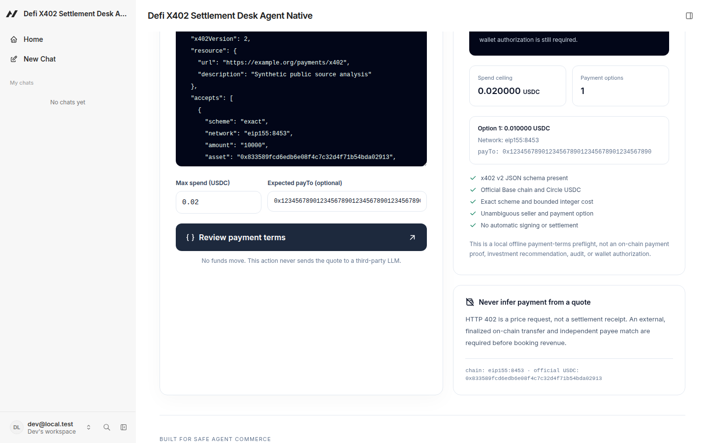
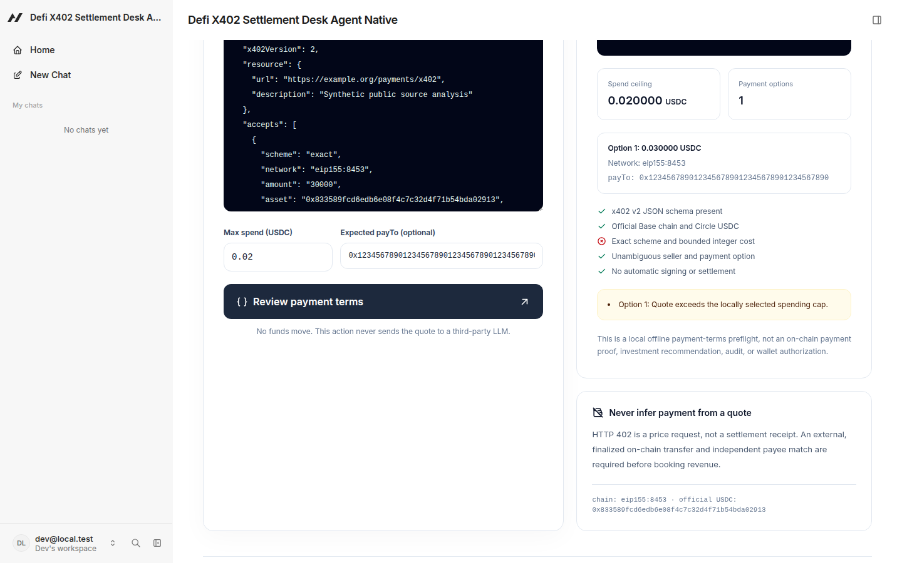

# DeFi Payment Desk

A human-review-first **x402 v2 payment-terms safety desk**, built with [Agent-Native](https://github.com/BuilderIO/agent-native). Designed for AI agents and operators reviewing small paid DeFi/API calls **before** touching a wallet.

**Status (25 October 2026):** working local prototype. **Not** a deployed merchant/payment processor, an audit, an on-chain revenue verifier or a submitted/awarded hackathon entry.

## The problem

An autonomous agent sees HTTP 402 ("payment required") from an API and may be tempted to blindly pay. But the same payload may request another chain, a spoofed token, a changed merchant recipient, an unexpected price or an ambiguous set of payment options. A quoted price is **not a receipt**.

DeFi Payment Desk forces an explicit, explainable review of those terms. The local user chooses a strict maximum USDC amount and an optional pre-approved public recipient. The analyzer will **never sign, approve, transfer, bridge or even connect a wallet**.

## What works now

- Parse *public* x402 **v2** `PAYMENT-REQUIRED` JSON (one to ten offered options).
- Require exact payments on **Base mainnet** (`eip155:8453`) in official native Circle USDC (`0x833589fcd6edb6e08f4c7c32d4f71b54bda02913`).
- Compare the exact `payTo` EVM recipient with an approved expected address, when provided.
- Compare **BigInt micro-USDC** against a locally chosen user cap. No floating-point currency arithmetic.
- Reject negative, zero, non-canonical, fractional or oversized atomic amounts, wrong payment schemes and invalid/oversized payment timeouts.
- Mark multiple payment options or absent public resource metadata as requiring **manual review**, even when every option individually passes.
- Display risk verdict, reason, payment options and explicit checklist in a responsive React UI.
- Expose the **same typed policy** through one Agent-Native action, reusable from agent, UI, CLI and MCP. No duplicate inconsistent payment evaluators.
- Automated deterministic unit tests and source type-checks. No real vendor API tests or funds required.

Local decision semantics:
- `BLOCK`: A required risk/syntax policy failed; do not connect a wallet.
- `REVIEW`: Terms are individually acceptable but ambiguous; user must review.
- `READY_FOR_HUMAN_REVIEW`: Basic quote constraints passed, **not** permission or proof of payment. A separate explicit human approval would still be needed outside this app.

### Actual isolated-browser UI proof

The following screenshots were captured from the local Agent-Native UI against **synthetic merchant quotes**, exercising the same action from the browser (not hand-drawn mockups). GitHub Actions and deterministic unit tests independently validate the pure payment engine.





## Run locally (no wallet)

Tested using Node.js 22, pnpm 10.29.1, Agent-Native 0.220.0.

```sh
pnpm install --frozen-lockfile --ignore-scripts
pnpm test
pnpm typecheck
# Only for trusted local development. Never set AUTH_DISABLED on a public deployment.
NODE_ENV=development AUTH_DISABLED=true PORT=4173 AGENT_TERMINAL_ENABLED=false \
  pnpm exec agent-native dev --host 127.0.0.1 --port 4173 --strictPort
```

On Linux with `/usr/bin/google-chrome`, optionally run `pnpm run demo:verify` in a separate terminal while the server is active to produce an isolated, credential-free browser walk-through in gitignored `.tmp/`.

Visit `http://127.0.0.1:4173/desk`. The app starts on `/home` as well; use **Load valid example** and **Try over-cap example**. The demo payloads are synthetic and payment-free.

To invoke the same action from the CLI:

```sh
NODE_ENV=development AUTH_DISABLED=true PORT=4173 pnpm action quote-guard \
  --quoteText "$(cat examples/valid-quote.json)" \
  --maxSpendUsdc 0.02 \
  --expectedRecipient 0x1234567890123456789012345678901234567890
```

Try `examples/over-cap-quote.json`: amount 20,001 micro-USDC must be blocked against a 0.02 USDC (20,000 micro) cap.

**Important:** This repository includes the original Agent-Native chat/template infrastructure. Local PGlite is for development only. A **public production deployment requires a securely managed `BETTER_AUTH_SECRET` and a persistent `DATABASE_URL`/Postgres service**. Do not deploy with `AUTH_DISABLED=true`. No production hosting or wallet-signing is assumed or represented here.

## Architecture

```text
Browser review UI /home and /desk   Autonomous Agent / MCP / CLI
                \                 /
             Agent-Native action
               quote-guard
                  |
     shared/quote-guard.ts (pure)
          |       |          |
       schema   policy    BigInt cap
          \       |          /
         local structured verdict
                  |
        human review, NEVER payment
```

| Component | Purpose |
| --- | --- |
| `shared/quote-guard.ts` | Pure deterministic quote-policy engine, no IO |
| `actions/quote-guard.ts` | Agent-Native shared typed action (read-only) |
| `app/routes/desk.tsx` | UI with synthetic quote examples and verdict |
| `tests/quote-guard.test.ts` | Valid/invalid chain, asset, cap, address, timeout, scheme, v1/v2, precision |
| `examples/*.json` | Public synthetic, credential-free fixtures |

## Separate live agent-paid workflow SKU
The same original beneficial owner also operates a **different product**: static GitHub Actions YAML preflight at https://vm2-workflow-x402.onrender.com/v1/docs with a 0.005 native Base Circle USDC micro-result and 0.02 native Base Circle USDC full report, plus a free sample at /v1/sample. These x402v2 routes have independently verified unsigned 402 payment quotes. The agent buyer must authorize its own optional payment; this GitHub Pages website never signs or pays. No finalized outside buyer receipts or product sales are assumed merely because an API is live.

## Paid integration work

For teams implementing x402 APIs, we can discuss an **independently agreed paid** mini-review of public/synthetic payment challenge formats and buyer-facing preflight UX. Work would be transparently AI-assisted, scope and acceptance defined in writing, no production penetration testing without separate authorization, no advance purchaser funds requested to perform the quote review. Commercial inquiries: **onecursor1@gmail.com**. A posted example, GitHub star, proposal or unpaid demo is **not a sale**.

## Hackathon candidate

Original implementation built on **25 October 2026**, within the [Builder.io Agent-Native Hackathon](https://www.builder.io/hackathon) 19 October–2 November 2026 build window. **Candidate only.** To enter, the legitimate human operator must independently verify age/location eligibility, obtain a public **Clips** demonstration of actual working app behavior, submit the official entry form before **2 November 2026, 11:59 PM PT**, and verify submission acknowledgment. Award totals are advertised possibilities, **not revenue**. No human identity or tax details are fabricated.

## Trust and attribution

The Agent-Native app skeleton is based on Builder.io's MIT-licensed 0.220.0 `create --standalone --template chat` scaffold. Original DeFi safety logic, quote action, examples, tests and review UI were added for this project. The upstream core/toolkit remain subject to their MIT licenses and copyright notices. See the project's MIT license for original additions.

Do not paste secrets into the app. The reviewer's synthetic `payTo` address is **not** a payee or deposit address. For real purchases, verify the seller through an independent trusted channel, consider refunds and gas, and inspect an independently finalized chain receipt **after** a real human-authorized payment.
